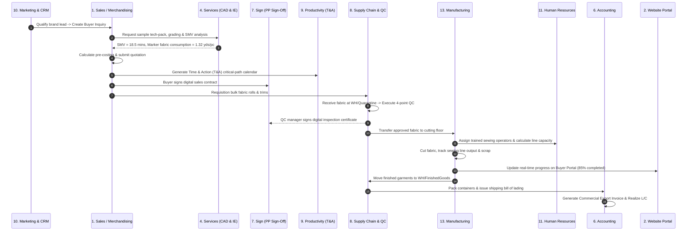

# Garment ERP Enterprise Blueprint: 13-Module Architecture & Rollout Plan

> **Author:** Principal Enterprise Architect (Apparel Manufacturing & Tier-1 ERP Systems)  
> **Target Platform:** Texon (Next.js 15 + Django 5) & Odoo 20.0 Community Edition (Self-Hosted + OCA)  
> **Scope:** Full-Suite Garment ERP (Sales, Website, Helpdesk, Services, Appraisals, Accounting, Sign, Supply Chain, Productivity, Marketing, Human Resources, Administration, Manufacturing)  
> **Status:** Approved Architectural Blueprint & Implementation Specification  

---

## Executive Architectural Strategy

A modern export garment manufacturing and buying house operates on narrow margins, aggressive Time & Action (T&A) deadlines, and rigorous international compliance standards. Disconnected software silos lead to order delays, air-freight penalties, and fabric wastage.

This master plan structures the **13 core enterprise modules** requested for the Texon Garment ERP platform. It establishes a unified hybrid architecture:
- **Odoo 20.0 Community (+ OCA Extensions):** Acts as the **authoritative transactional core** for accounting, inventory quants, purchase orders, standard sales orders, basic HR, and core MRP.
- **Texon Specialized Apparel Platform:** Acts as the **high-cadence garment domain engine** providing size-color matrix ordering, tech-packs, roll shade grouping, 4-point fabric inspection, floor bundle tracking, buyer portals, and T&A critical-path engines.

---

## Master Module Matrix: The 13 Pillars of Garments ERP

```
                                  ┌─────────────────────────────────────────┐
                                  │       TEXON GARMENTS ERP PLATFORM       │
                                  └─────────────────────────────────────────┘
                                                       │
         ┌────────────────────────┬────────────────────┴───────────────────┬────────────────────────┐
         ▼                        ▼                                        ▼                        ▼
┌──────────────────┐    ┌──────────────────┐                     ┌──────────────────┐    ┌──────────────────┐
│ 1. COMMERCIAL    │    │ 2. SUPPLY CHAIN  │                     │ 3. MANUFACTURING │    │ 4. ENTERPRISE    │
│ & BUYER FACING   │    │ & LOGISTICS      │                     │ & QUALITY        │    │ MANAGEMENT       │
├──────────────────┤    ├──────────────────┤                     ├──────────────────┤    ├──────────────────┤
│ • Sales          │    │ • Supply Chain   │                     │ • Manufacturing  │    │ • Accounting     │
│ • Website Portal │    │ • Warehouse/Lots │                     │ • Quality / QC   │    │ • HR & Payroll   │
│ • Marketing      │    │ • Procurement    │                     │ • Services (IE)  │    │ • Appraisals     │
│ • Helpdesk       │    │ • Subcontracting │                     │ • Sign (Audits)  │    │ • Productivity   │
│                  │    │                  │                     │                  │    │ • Administration │
└──────────────────┘    └──────────────────┘                     └──────────────────┘    └──────────────────┘
```

---

## Pillar 1: Sales (Merchandising & Buyer Order Management)

### 1. Garment Industry Context
In apparel manufacturing, "Sales" is managed by the Merchandising department. An order is rarely a single SKU; it is a complex **Style matrix** spanning multiple colorways (e.g., *Navy, Olive, Heather Grey*) and size ratios (*S:M:L:XL = 1:2:2:1*), governed by strict buyer delivery windows, incoterms (FOB, CIF), and garment specifications.

### 2. Architecture & Ownership
- **Texon Domain:** Style creation, buyer tech-pack specs, pre-costing/CM (Cost of Making) calculation, sample order approvals, and size/color matrix order grid.
- **Odoo Domain:** Master Customer Ledger (`res.partner`), Confirmed Sales Orders (`sale.order`), Sales Order Lines (`sale.order.line`) linked to variant SKUs (`product.product`).
- **Integration Engine:** When a buyer PO is approved in Texon, an outbox command creates and confirms an authoritative Odoo `sale.order`.

### 3. Key Data Models & Workflows
```
Buyer Inquiry ──> Pre-Costing / CM ──> Sample Approval ──> Buyer PO Matrix ──> Odoo Sale Order
```
- `merchandising.BuyerPurchaseOrder`: Stores buyer ref, incoterms, payment terms, season, style reference.
- `merchandising.BuyerOrderItem`: Matrix breakdown of size, color, quantity, unit price, and factory delivery date.
- `costing.PreCosting`: Fabric consumption (yards/dz), trims, embellishments, wash cost, CM, and target margin.

---

## Pillar 2: Website (B2B Buyer Portal & Digital Showroom)

### 2. Garment Industry Context
International brands (e.g., H&M, Zara, PVH, Target) demand real-time visibility into order status, lab-dip approvals, shipping schedules, and sustainable fabric credentials. Additionally, factories need a digital B2B showroom to pitch upcoming seasonal collections to prospective international clients.

### 2. Architecture & Ownership
- **Texon Next.js Frontend:** Provides a branded, high-performance **Buyer Self-Service Portal** and **Virtual 3D/Photo Showroom** (SSR/SSG with Next.js App Router).
- **Odoo Domain:** Odoo `website` module and `portal` providing account invoices, payment receipts, and delivery documents.

### 3. Key Features & Workflows
- **Digital Showroom:** Seasonal collections classified by style, fabric composition, GSM, and lead times.
- **Order Tracking Portal:** Buyers log in to track PO milestones (*Fabric Booked -> In Cutting -> Sewing 60% -> Final Inspection -> Vessel Departure*).
- **Digital Swatch & Lab-Dip Approvals:** Buyer comments and approvals on strike-offs and shade bands directly within the portal.

---

## Pillar 3: Helpdesk (Buyer Claims, QC Disputes & Factory Support)

### 3. Garment Industry Context
Apparel manufacturing involves frequent commercial claims: short-shipments, shade variation rejections, measurement spec discrepancies, or shipment delays. Internally, sewing lines encounter mechanical machine breakdowns requiring rapid maintenance intervention.

### 2. Architecture & Ownership
- **Odoo Domain:** OCA `helpdesk_mgmt` module (Open Source LGPL-3) providing SLA tracking, ticket categorization, and email routing.
- **Texon Domain:** Integrated Helpdesk UI inside the Buyer Portal and Factory Floor Maintenance App.

### 3. Key Workflows & Ticket Types
1. **Commercial Buyer Claims:** Chargeback requests, air-freight liability claims, defect percentage penalties.
2. **Quality & Fit Rejections:** Buyer sample revisions with annotated fit photos and POM (Points of Measure) delta sheets.
3. **Internal Line Maintenance Tickets:** Sewing machine breakdown logged by line supervisor with response time SLA tracking.

---

## Pillar 4: Services (Sample Room, Pattern CAD & Industrial Engineering)

### 4. Garment Industry Context
Before bulk production, garment factories run extensive technical service workflows:
- **Sample Room:** Prototypes, Fit samples, Size sets, Salesman samples (SMS), and Pre-Production (PP) samples.
- **Pattern CAD:** Digitization, grading across sizes, marker making, and fabric utilization efficiency.
- **Industrial Engineering (IE):** Method study, calculating SMV (Standard Minute Value), line layout, and target line balancing.

### 2. Architecture & Ownership
- **Odoo Domain:** `project` and `hr_timesheet` tracking sample development projects, design hours, and CAD costs.
- **Texon Domain:** Specialized `ie_planning` and `tna` modules for apparel SMV calculations and line planning.

### 3. Key Data Models & Workflows
- `ie_planning.StyleAnalysis`: Operation breakdown (e.g., *Collar Make = 1.25 min, Sleeve Attach = 0.85 min*) and total garment SMV.
- `ie_planning.LinePlan`: Target pieces per hour calculated from SMV, planned operators, and target efficiency percentage.
- `merchandising.SampleOrder`: Development tracking with buyer feedback history and dispatch courier tracking.

---

## Pillar 5: Appraisals (Operator Efficiency & Staff Performance)

### 5. Garment Industry Context
In garment factories, productivity and quality depend directly on sewing operator skill. Performance must be tracked objectively via **Operator Efficiency %, DHU (Defects per Hundred Units), and Attendance**. For white-collar staff (merchandisers, pattern makers), performance is measured against revenue targets, on-time delivery rates, and sample approval success.

### 2. Architecture & Ownership
- **Texon Domain:** Live floor telemetry calculating operator and line efficiency from daily piece records.
- **Odoo Domain:** OCA `hr_appraisal` / `hr_evaluation` managing 360-degree reviews, quarterly evaluations, and promotion tracks.

### 3. Key Metrics & Appraisals
- **Sewing Operator Scorecard:**
  $$\text{Individual Efficiency \%} = \frac{\text{Produced Pieces} \times \text{Operation SMV}}{\text{Worked Minutes}} \times 100$$
- **Quality Penalty Index:** Reduction based on end-line QC defect logs and rework rates.
- **Merchandiser Appraisal:** On-Time In-Full (OTIF) delivery rate, buyer profit margin, and claim deductions.

---

## Pillar 6: Accounting (Invoicing, General Ledger & Export Trade Finance)

### 6. Garment Industry Context
Garment exports involve specialized international trade finance: **Letters of Credit (L/C), Back-to-Back L/Cs for fabric imports, Export Development Fund (EDF), Bill of Exchange realization, customs duty drawbacks, and multi-currency exchange gains/losses**. Standard generic accounting software fails without export trade mechanics.

### 2. Architecture & Ownership
- **Odoo Domain (Authoritative):** Odoo `account` module owns chart of accounts, general ledger, accounts payable/receivable, bank statements, and tax rules.
- **Texon Domain:** Specialized `commercial` app managing Master L/C contracts, Back-to-Back L/Cs, shipping documents, and trade realizations.

### 3. Key Data Models & Workflows
```
Master L/C (Buyer) ──> Back-to-Back L/C (Mill) ──> Commercial Invoice ──> Bank Negotiation / Realization
```
- `commercial.LetterOfCredit`: Master L/C number, issuing bank, expiry date, shipment deadline, and credit value.
- `commercial.Invoice`: Export invoice linked to bill of lading, container number, packing list, and HS codes.
- `commercial.Realization`: Foreign currency inflow, bank charges, loan adjustment, and exchange variance posting into Odoo journal.

---

## Pillar 7: Sign (E-Signature, Compliance & Quality Sign-Offs)

### 7. Garment Industry Context
Garment manufacturing requires formal sign-offs across multiple legal and compliance gates:
- **Buyer PO Acceptance:** Binding contracts between factory and international brand.
- **Pre-Production (PP) Meeting Sign-Off:** Technical sign-off between Factory Manager, Merchandiser, and Quality Head before cutting starts.
- **Social Compliance Audits:** Worker union agreements, fire safety logs, and environmental compliance audits (WRAP, BSCI, OEKO-TEX).

### 2. Architecture & Ownership
- **Texon Frontend:** Integrated Next.js HTML5 canvas and cryptographic signing pad.
- **Backend / Odoo:** Storing immutable PDF hashes, signer audit trails (timestamp, IP, authenticated user ID), and digital certificates.

### 3. Key Signed Workflows
1. **PP Meeting Golden Seal:** Digital sign-off locking the approved garment sample and BOM.
2. **Fabric Inspection Release Certificate:** QC manager signs off on fabric roll release from quarantine.
3. **Subcontract Agreement:** Legal terms signed before cut panels are dispatched to outsourced washing/embroidery mills.

---

## Pillar 8: Supply Chain (Procurement, Warehousing & Roll Lot Logistics)

### 8. Garment Industry Context
Fabric represents 60–70% of the total garment cost. Supply chain failure (e.g. wrong shade fabric, missing sewing thread, delayed zipper delivery) halts production lines instantly. Fabric rolls must be tracked individually by **supplier dye batch, shade lot (A/B/C), GSM, and shrinkage rate**.

### 2. Architecture & Ownership
- **Odoo Domain (Authoritative):** `purchase` (Supplier POs), `stock` (Warehouses, picking, delivery, and stock moves), `stock.lot` (Fabric roll traceability).
- **Texon Domain:** 4-point fabric inspection terminal, shade band sorting, and raw material booking requisitions.

### 3. Key Models & Warehouse Topology
```
Supplier PO ──> Receipt at WH/Quarantine ──> 4-Point QC & Shade Test ──> Transfer to WH/Stock ──> Issue to Cutting
```
- **Locations in Odoo:**
  - `WH/Quarantine`: Incoming uninspected fabric and trims.
  - `WH/Stock`: Quality-approved bulk fabric available for allocation.
  - `WH/Shade_A`, `WH/Shade_B`: Physical shelf bins sorted by visual color shade.
  - `WH/RejectedStock`: Defective fabric isolated for supplier return.
- **Odoo `stock.lot` Garment Attributes:** Dye lot, measured GSM, warp/weft shrinkage %, and usable width.

---

## Pillar 9: Productivity (Time & Action, Tasks & SOP Knowledge Base)

### 9. Garment Industry Context
The **Time & Action (T&A) Calendar** is the beating heart of garment factory operations. Missing a single milestone (e.g., *Lab Dip Approval by Day 15* or *Yarn In-House by Day 30*) guarantees a delayed shipment. Factories also require standard operating procedures (SOPs) for fabric washing recipes, sewing machinery maintenance, and buyer packaging guidelines.

### 2. Architecture & Ownership
- **Texon Domain:** High-performance Gantt chart and critical-path T&A calendar ([tna](file:///home/afzal/Desktop/texon/backend/tna) app) with automated delay alarms.
- **Odoo Domain:** `calendar`, `note`, and `knowledge` for enterprise document management and SOP wikis.

### 3. Key Features & Workflows
- **Dynamic T&A Engine:** Generates backward-scheduled milestone dates from target vessel shipment date.
- **Alarm Notifications:** Alerts merchandisers when a supplier booking or sample approval is within 48 hours of critical-path breach.
- **Factory Knowledge Base:** Buyer-specific packaging manuals, stitch quality standards, and chemical safety data sheets.

---

## Pillar 10: Marketing (B2B Lead Generation & Brand Outreach)

### 10. Garment Industry Context
Garment exporters require proactive international business development. Sourcing managers at fashion brands change frequently, and seasonal buying cycles (Spring/Summer, Autumn/Winter) require timed outreach with new lookbooks, fabric innovations, and compliance certifications.

### 2. Architecture & Ownership
- **Odoo Domain:** `crm` (Lead pipeline, opportunity stages), `mass_mailing` (HTML email campaigns, open/click analytics).
- **Texon Domain:** Linked buyer database and historical profitability analysis (`crm.BuyerProfitability`).

### 3. Key Marketing Workflows
1. **Trade Show Lead Capture:** Scanning business cards at international apparel fairs (e.g. Magic Las Vegas, Premiere Vision Paris) into Odoo CRM.
2. **Seasonal Lookbook Campaigns:** Automated email marketing showcasing new sustainable organic cotton styles with click tracking.
3. **Buyer Qualification Pipeline:** Stages: *Initial Contact -> Sample Request -> Factory Audit -> Vendor Code Issued -> First PO*.

---

## Pillar 11: Human Resources (Workforce, Biometrics, Attendance & Payroll)

### 11. Garment Industry Context
Apparel factories employ thousands of floor workers across cutting, sewing, washing, and finishing. The HR system must handle:
- **Biometric Attendance Integration:** Thousands of card/fingerprint swipes during shift changes.
- **Complex Shift Rules:** Day/night shifts, general shifts, and Friday overtime.
- **Payroll Compliance:** Minimum wage laws, overtime rate calculations (200% base rate), festival bonuses, and attendance allowances.
- **Social & Labor Compliance:** Ensuring overtime hours do not violate international buyer audit limits (e.g. maximum 60 hours/week).

### 2. Architecture & Ownership
- **Texon Domain:** Specialized Bangladesh/international apparel payroll, overtime sheet calculations (`hr.Overtime`, `hr.SalarySheet`), and attendance logs.
- **Odoo Domain:** Master Employee Directory (`hr.employee`), Departments (`hr.department`), Leave Management (`hr.leave`), and Contracts.

### 3. Key Models & Workflows
```
Biometric Punch ──> Shift & Overtime Calculation ──> Compliance Check ──> Monthly Salary Sheet
```
- `hr.Employee`: Line assignment, designation, skill level (helper, junior operator, senior operator), basic salary, and bank details.
- `hr.Attendance`: Clock-in, clock-out, late minutes, and authorized leave status.
- `hr.Overtime`: Daily approved overtime minutes multiplied by compliance multiplier.

---

## Pillar 12: Administration (Multi-Company, Security, RBAC & Audit Trails)

### 12. Garment Industry Context
Garment conglomerates typically comprise multiple legal entities: a knitting mill, a dyeing unit, a woven factory, and a buying house. Administration requires strict multi-company boundary protection, role-based access control (preventing merchandisers from seeing operator wages or storekeepers from seeing margins), and audit trails.

### 2. Architecture & Ownership
- **Odoo Domain:** Odoo `res.company` hierarchy, security groups (`res.groups`), and database manager.
- **Texon Domain:** `rbac` module (roles, permissions, role-permissions), company scoping middleware, and immutable audit logs.

### 3. Security Specifications
- **Strict Tenant Separation:** Database-per-customer routing for SaaS deployments.
- **Company Context Enforcement:** Every backend query and outbox message is filtered by `company_id`.
- **RBAC Matrix:**
  - *Merchandiser:* Full access to Sales, Styles, Costing; Read-only on Inventory; No access to HR/Payroll.
  - *Storekeeper:* Full access to Fabric/Trim receipts, QC Quarantine, and Stock issues; No access to Pricing/Margins.
  - *Production Manager:* Full access to MOs, Cutting, Sewing, Line planning; No access to Financial accounts.

---

## Pillar 13: Manufacturing (Cutting, Sewing, Washing, Finishing & Subcontracting)

### 13. Garment Industry Context
Manufacturing is the core engine of apparel production. Garment MRP is unique because fabric is cut into bundles of parts (*front panel, back panel, sleeves, collar*), numbered to preserve dye lot consistency, sewn along production lines, washed in industrial laundries, and pressed/packed.

### 2. Architecture & Ownership
- **Odoo Domain (Authoritative):** `mrp` (Manufacturing Orders, Work Centers, Routing), `mrp_subcontracting` (Outsourced laundry, printing, and embroidery).
- **Texon Domain:** Cut Order Planning (marker planning, ratio calculation), Bundle Ticket printing with QR codes, Floor terminal production logging, and Defect heatmap tracking.

### 3. Key Models & Floor Flow
```
Marker Cut Plan ──> Roll Spreading & Cutting ──> Bundle QR Print ──> Sewing Line Tracking ──> Finishing & Packing
```
- `production.ProductionOrder`: Bound to Odoo `mrp.production` with target quantity per size/color.
- `production.CuttingRecord`: Meters of fabric roll consumed, plies cut, cut pieces generated, and end-loss/scrap.
- `production.DefectLog`: Hourly defect data mapped to specific line stations (e.g. *Station 14: Skipped Stitch*).
- `subcontract.SubcontractOrder`: Dispatched cut panels to external embroidery/print mills with gate-pass tracking.

---

## Cross-Module Integration Blueprint: The Apparel Order Lifecycle

To understand how all 13 modules work as a single synchronized enterprise engine, follow a single garment order from customer acquisition to shipment:



---

## 4-Phase Implementation & Rollout Roadmap

Implementing all 13 modules requires a disciplined phased rollout to prevent organizational overload in the factory:

### Phase 1: Core Commercial & Operational Foundation (Months 1–3)
- **Modules:** `1. Sales`, `8. Supply Chain`, `13. Manufacturing`, `12. Administration`.
- **Deliverables:** Style/variant matrices, Odoo 20 stock lot receiving, fabric quarantine, cutting/sewing MOs, and user RBAC.

### Phase 2: Financial Integrity & Quality Gatekeeping (Months 4–6)
- **Modules:** `6. Accounting`, `7. Sign`, `3. Helpdesk`, `9. Productivity`.
- **Deliverables:** Odoo double-entry ledger, commercial export invoices, T&A critical-path engine, buyer claim ticketing, and digital PP approvals.

### Phase 3: Workforce Intelligence & Technical Services (Months 7–9)
- **Modules:** `11. Human Resources`, `5. Appraisals`, `4. Services (CAD/IE)`.
- **Deliverables:** Biometric attendance, sewing operator efficiency scoring, sample room project tracking, and SMV method studies.

### Phase 4: Buyer Digital Experience & Growth (Months 10–12)
- **Modules:** `2. Website Portal`, `10. Marketing`, AI Copilot Extensions.
- **Deliverables:** Buyer B2B tracking portal, seasonal lookbook showroom, CRM brand lead pipeline, and the natural-language AI Command Center.
