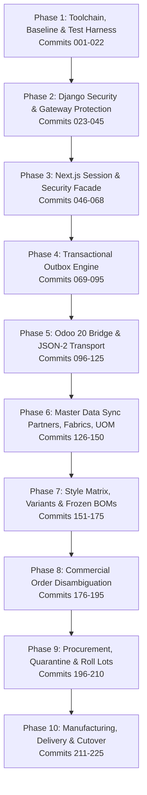

# Texon & Odoo 20.0 ERP Integration: Master Architectural Blueprint

> **Role:** Principal Enterprise Solutions Architect (Apparel Manufacturing & Tier-1 ERP Systems)  
> **Target Release:** Odoo 20.0 Community Edition (Self-Hosted) & Texon (Next.js 15 / Django 5)  
> **Status:** Final Architectural Specification & Implementation Directive  

---

## Executive Summary & Strategic Directive

Texon was conceived as a rich, domain-focused ERP tailored to the high-cadence realities of garment merchandising, sample development, and apparel manufacturing in South Asia. However, sustaining independent, home-grown implementations of double-entry accounting, real-time perpetual inventory valuation, complex material requirement planning (MRP), and multi-currency taxation across international borders introduces crippling maintenance overhead.

By adapting **Odoo 20.0 Community Edition (Self-Hosted)** as the **Authoritative Transactional Ledger** while retaining **Texon as the Apparel Specialized Collaboration, Tech-Pack, and Operational Portal**, we achieve an enterprise-grade, international-ready solution:
1. **Zero Reinvention of ERP Primitives:** Odoo provides battle-tested double-entry journal postings, standard inventory moves, reservations, picking routes, and core manufacturing orders.
2. **Preservation of Apparel IP:** Texon provides size/color matrix ordering, tech-pack revisions, fabric roll shade sorting, 4-point fabric inspection, buyer sample tracking, and specialized merchandising dashboards.
3. **Resilient Distributed Consistency:** Unidirectional authoritative domain ownership driven by a guaranteed **Transactional Outbox & Inbox Engine**, eliminating bi-directional sync split-brain scenarios.

---

## Master Documentation Suite

The complete engineering and testing blueprint has been organized into modular, detailed specifications within the `docs/` hierarchy:

| Document | Purpose & Key Contents |
|---|---|
| **[GARMENT_ERP_13_MODULES_MASTER_PLAN.md](GARMENT_ERP_13_MODULES_MASTER_PLAN.md)** | **Full 13-Module Garment ERP Blueprint:** Comprehensive domain architecture covering Sales, Website, Helpdesk, Services, Appraisals, Accounting, Sign, Supply Chain, Productivity, Marketing, HR, Administration, and Manufacturing. |
| **[03-technical-problem-solving.md](integration_design/03-technical-problem-solving.md)** | **Deep Architectural Solutions:** Single authority matrix, outbox/inbox schema, Odoo JSON-2 RPC transport, atomic `texon_bridge` addon, multi-tenant company isolation, DRF security fixes, garment variant matrices, frozen BOM revisions, roll lot tracking, UOM traps, and Next.js cookie session unification. |

| **[04-200-commit-implementation-roadmap.md](integration_design/04-200-commit-implementation-roadmap.md)** | **Complete 225-Commit Implementation Roadmap:** 225 sequentially numbered, reviewable atomic git commits spanning 10 sequential epics. Every commit specifies target files, implementation intent, and paired test acceptance criteria for engineers and QA testers. |
| **[01-odoo-architecture-baseline.md](odoo_research/01-odoo-architecture-baseline.md)** | **Odoo 20.0 CE Research Baseline:** Edition trade-offs (CE vs Enterprise vs Odoo.sh), JSON-2 RPC protocol, removal of legacy `db` RPC service, LGPL-3 licensing, and technical validation gates. |
| **[02-backend-static-audit.md](odoo_research/02-backend-static-audit.md)** | **Backend Audit & Model Inventory:** Audit of `backend/` at HEAD `539fdb37`, complete inventory of 105 Django models across 24 apps, DRF permission leak analysis, and retiring generic CRUD routes. |
| **[01-system-architecture-and-sync.md](integration_design/01-system-architecture-and-sync.md)** | **Integration Architecture & 15 Acceptance Scenarios:** Cross-system consistency rules, cutover strategy, and 15 concrete test scenarios for verifying network timeouts, concurrency, shortages, and recoveries. |
| **[02-frontend-static-audit.md](integration_design/02-frontend-static-audit.md)** | **Frontend Audit & UI Inventory:** Audit of `frontend/texon-ui/` uncovering 210 `page.tsx` routes, transport contradictions (REST vs GraphQL), duplicate JWT stores, and client-side pagination anti-patterns. |
| **[05-ai-copilot-integration-plan.md](integration_design/05-ai-copilot-integration-plan.md)** | **AI Copilot Architecture & Phase 11 Roadmap:** Blueprint restoring `backend/ai` with Django Channels streaming, 4 specialized apparel skills (Production, Fabric Lots, Merchandising, Human-in-the-Loop Command Drafter), and 15 implementation commits (`COMMIT-226` to `240`). |

---

## The 10-Phase Implementation Roadmap Overview

The 225 commits detailed in **[04-200-commit-implementation-roadmap.md](integration_design/04-200-commit-implementation-roadmap.md)** are sequenced across ten structured phases:

### Epic Breakdown:
1. **Phase 1 (Commits 001–022):** Standardizes toolchains (Node 20 LTS, pnpm, Python 3.12+), removes ASGI crashes, builds dockerized Postgres/Redis/Odoo 20 development environments, and configures automated test runners.
2. **Phase 2 (Commits 023–045):** Hardens Django security by replacing DRF's leaky `DjangoModelPermissions` with `StrictModelPermissions`, removing staff tenant bypasses, and disabling generic CRUD writes on core ERP models.
3. **Phase 3 (Commits 046–068):** Eliminates browser `localStorage` JWT token storage in Next.js, implementing secure HttpOnly cookies, single-flight token refresh, and a Next.js BFF proxy route.
4. **Phase 4 (Commits 069–095):** Implements the robust Transactional Outbox & Inbox engine in Django with Celery workers, `select_for_update(skip_locked=True)`, SHA-256 payload verification, exponential backoff, and dead-letter queues.
5. **Phase 5 (Commits 096–125):** Builds the custom Odoo 20 addon `texon_bridge` providing atomic service methods, idempotent command receipt tracking (`texon.command.receipt`), and secure JSON-2 RPC client communication.
6. **Phase 6 (Commits 126–150):** Synchronizes Buyers, Suppliers, internal warehouse locations (`WH/Stock`, `WH/Quarantine`), raw material fabrics, and eliminates arbitrary kg-to-meter UOM conversions.
7. **Phase 7 (Commits 151–175):** Models garment styles, generates color/size variant SKUs deterministically in Odoo, creates variant-applicable BOMs, and establishes immutable BOM revision locking.
8. **Phase 8 (Commits 176–195):** Deprecates redundant `orders.Order`, establishes `merchandising.BuyerPurchaseOrder` mapping to Odoo `sale.order`, and implements size/color order matrix confirmation.
9. **Phase 9 (Commits 196–210):** Maps raw material supplier orders to Odoo `purchase.order`, receives fabric rolls into `WH/Quarantine`, executes 4-point QC inspections, and releases approved rolls to `WH/Stock`.
10. **Phase 10 (Commits 211–225):** Dispatches manufacturing orders (`mrp.production`), tracks roll consumption and cutting scrap, validates customer delivery picking (`stock.picking`), generates customer invoices, executes all 15 acceptance scenarios, and provides the production cutover script.

---

## Instructions for Implementing Engineers & QA Testers

1. **For Implementing Engineers:**
   - Execute the commits sequentially in the exact order specified in [04-200-commit-implementation-roadmap.md](integration_design/04-200-commit-implementation-roadmap.md).
   - Adhere strictly to the **Target Files** and **Implementation Intent** defined for each commit.
   - Never write direct SQL queries against Odoo database tables; all mutations must be routed via `texon_bridge` and outbox commands.
   - When introducing business logic, write the accompanying unit and integration tests within the same commit.

2. **For QA Automation Engineers:**
   - Implement the paired automated tests specified under **Acceptance & Paired Tests** for each commit.
   - Validate the system against the **15 End-to-End Acceptance Scenarios** detailed in [01-system-architecture-and-sync.md](integration_design/01-system-architecture-and-sync.md), especially scenarios testing network timeouts, concurrent command delivery, and quality quarantine blocks.
   - Ensure the test suite executes in CI against a real dockerized Odoo 20 Community container, not mock objects alone.
