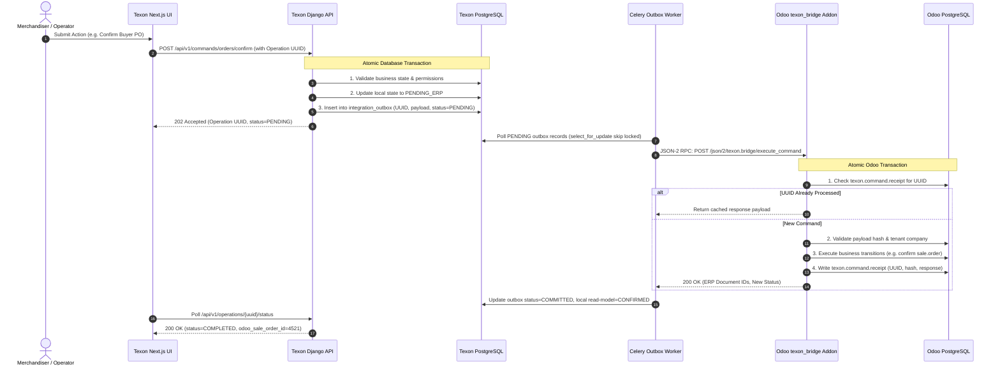

# Deep Technical Problem Solving: Texon & Odoo 20.0 ERP Adaptation

> **Author:** Principal Enterprise Architect (10+ Years Apparel ERP & Integration Systems)  
> **Status:** Implementation-Ready Architecture Specification  
> **Target Release:** Odoo 20.0 Community Edition (Self-Hosted) & Texon (Django 5.x / Next.js 15)  

---

## Executive Architectural Summary

Integrating an existing domain-heavy apparel ERP (Texon) with an authoritative open-source ERP (Odoo 20.0 Community) is not a simple matter of synchronizing tables or wrapping REST APIs. It requires resolving fundamental **data ownership, transactional consistency, domain modeling, and security boundary conflicts**.

In a production garment manufacturing ecosystem, duplicate records of truth lead to catastrophic operational failures: double-booked fabric inventory, corrupted cost sheets, desynchronized cutting orders, and phantom shipments. This document provides the concrete engineering specifications and mathematical/algorithmic safeguards to ensure seamless, zero-drift adaptation.

---

## 1. Architectural System Boundary & Authority Matrix

### 1.1 The Single Authority Mandate
A core architectural anti-pattern is **bi-directional master synchronization**. When two systems believe they own inventory quantities, prices, or production states, network latency or concurrent updates inevitably cause split-brain divergence.

Texon will operate as the **Apparel Specialized Design, Tech-Pack, Merchandising, and Operational Portal**, while Odoo 20.0 Community acts as the **Authoritative Transactional Ledger (Stock, Orders, Accounting, and Core MRP)**.

| Domain Entity | Authoritative System | Texon Role | Odoo 20.0 Role | Sync Pattern |
|---|---|---|---|---|
| **Partner (Buyer/Supplier)** | **Odoo** | Read Projection & Fast Search | Master Ledger (`res.partner`) | Outbox Command (Create/Update) → Odoo → Event back |
| **Garment Style & Tech-Pack**| **Texon** | Master Author (`merchandising.Style`) | Catalog Template (`product.template`) | Texon outbox pushes approved style revision to Odoo |
| **Size/Color Matrix (SKUs)** | **Odoo** | Design Matrix UI | Variant Records (`product.product`) | Generated deterministically from Texon approved matrix |
| **Bill of Materials (BOM)**   | **Odoo** | Garment Consumption Spec | Authoritative BOM (`mrp.bom`, `mrp.bom.line`)| Texon creates revision-frozen BOM in Odoo |
| **Physical Stock Balances**   | **Odoo** | Read-Only Cached Projections | Master Quantities (`stock.quant`, `stock.move`)| Event stream updates Texon read cache; writes forbidden |
| **Fabric Roll & Lot Tracking**| **Odoo** | Inspection & Shade Allocation UI | Tracked Lots (`stock.lot`, `stock.lot.quant`)| Lots received & quarantined in Odoo; queried by Texon |
| **Buyer Sales Orders**        | **Odoo** | Merchandising PO Matrix | Authoritative Order (`sale.order`, `sale.order.line`)| Texon command dispatches order; Odoo confirms & prices |
| **Supplier Purchase Orders**   | **Odoo** | Material Requisition Demand | Authoritative PO (`purchase.order`, `line`) | Texon requisition triggers Odoo procurement flow |
| **Manufacturing Orders (MO)** | **Odoo** | Floor Terminal Tracking | Production Orders (`mrp.production`, `workorder`)| Texon captures cutting/sewing; Odoo books moves & scrap |
| **Double-Entry Financials**   | **Odoo** | Unrendered / Summary Dashboards | Authoritative Moves (`account.move`, `line`) | Completely retired in Django; pure Odoo domain |

---

## 2. Cross-System Consistency: Transactional Outbox & Inbox Engine

Distributed transactions (2-Phase Commit / XA) are unsupported over HTTP/JSON-RPC and fragile across network boundaries. We employ a **guaranteed at-least-once delivery, idempotent exactly-once execution engine** using the Transactional Outbox pattern.



### 2.1 The Django Outbox Schema (`integration_outbox`)
```sql
CREATE TABLE integration_outbox (
    id BIGSERIAL PRIMARY KEY,
    operation_uuid UUID UNIQUE NOT NULL,
    tenant_id VARCHAR(64) NOT NULL,
    company_id INTEGER NOT NULL,
    aggregate_type VARCHAR(64) NOT NULL,
    aggregate_id VARCHAR(64) NOT NULL,
    command_name VARCHAR(128) NOT NULL,
    payload_hash VARCHAR(64) NOT NULL,
    payload JSONB NOT NULL,
    status VARCHAR(32) NOT NULL DEFAULT 'PENDING', -- PENDING, IN_FLIGHT, COMMITTED, FAILED, DEAD_LETTER
    retry_count INTEGER NOT NULL DEFAULT 0,
    max_retries INTEGER NOT NULL DEFAULT 5,
    next_retry_at TIMESTAMP WITH TIME ZONE DEFAULT NOW(),
    last_error TEXT,
    response_payload JSONB,
    created_at TIMESTAMP WITH TIME ZONE DEFAULT NOW(),
    updated_at TIMESTAMP WITH TIME ZONE DEFAULT NOW()
);
CREATE INDEX idx_outbox_poll ON integration_outbox (status, next_retry_at) WHERE status IN ('PENDING', 'FAILED');
```

### 2.2 Odoo Command Receipt (`texon.command.receipt`)
Inside Odoo, the `texon_bridge` module ensures idempotency by recording every processed command:
```python
class TexonCommandReceipt(models.Model):
    _name = "texon.command.receipt"
    _description = "Idempotent Execution Receipt for Texon Commands"

    operation_uuid = fields.Char("Operation UUID", required=True, index=True, readonly=True)
    company_id = fields.Many2one("res.company", "Company", required=True, index=True, readonly=True)
    command_name = fields.Char("Command Name", required=True, readonly=True)
    payload_hash = fields.Char("Payload Hash", required=True, readonly=True)
    response_data = fields.Text("Serialized Response JSON", readonly=True)
    status = fields.Selection([("success", "Success"), ("failed", "Business Failure")], required=True)
    executed_by = fields.Char("External Actor Ref", readonly=True)

    _sql_constraints = [
        ("unique_operation_uuid", "unique(operation_uuid)", "Operation UUID must be globally unique!")
    ]
```

### 2.3 Handling Network Timeouts ("Outcome Unknown")
When a network timeout occurs between Django and Odoo:
1. The Celery worker catches `requests.exceptions.Timeout`.
2. The worker **MUST NOT** assume the command failed. Odoo may have committed the transaction right before the TCP socket broke.
3. The worker flags `status='FAILED'` with backoff (`next_retry_at = now() + (2 ^ retry_count)`).
4. On the subsequent retry, the worker delivers the exact same `operation_uuid` and `payload`.
5. Odoo detects the existing `operation_uuid` in `texon.command.receipt`, skips re-execution, and returns the previously committed result.
6. If the payload has changed for the same `operation_uuid`, Odoo raises an `IntegrityError` (Payload Tamper Violation).

---

## 3. Odoo 20.0 Community Transport & Custom Addon (`texon_bridge`)

### 3.1 JSON-2 RPC Transport Specifications
Odoo 20 removes the legacy `xmlrpc/2/db` service and deprecates `xmlrpc/2/common` and `xmlrpc/2/object`. Communication must use the modern **JSON-2 RPC API**:
- **Endpoint:** `POST https://odoo.texon.internal/json/2/<model>/<method>`
- **Authorization:** `Bearer <RPC_TOKEN>` (token scoped to `bearer_scope='rpc'`)
- **Headers:** `Content-Type: application/json; charset=utf-8`

### 3.2 The Single-Transaction Addon Design
Every JSON-2 HTTP call in Odoo executes inside an individual database transaction. Standard Odoo client flows that require 3–5 separate calls (`create`, `onchange`, `action_confirm`, `button_validate`) are inherently non-atomic over RPC. If call 3 drops, the database is left with dirty, orphaned draft documents.

To solve this, all complex interactions are implemented inside our custom Odoo addon: `texon_bridge`.
```python
# odoo_addons/texon_bridge/models/bridge_service.py
class TexonBridgeService(models.AbstractModel):
    _name = "texon.bridge.service"
    _description = "Atomic Facade for Texon Integration"

    @api.model
    def execute_atomic_command(self, operation_uuid, company_id, command_name, payload):
        """
        Executes business commands atomically inside a single database transaction.
        Checks idempotency, switches company context safely, applies business rules.
        """
        Receipt = self.env["texon.command.receipt"]
        existing = Receipt.search([("operation_uuid", "=", operation_uuid)], limit=1)
        if existing:
            if existing.payload_hash != self._hash_payload(payload):
                raise exceptions.UserError("Operation UUID reused with altered payload.")
            return json.loads(existing.response_data)

        company = self.env["res.company"].browse(company_id)
        if not company.exists():
            raise exceptions.UserError(f"Target company {company_id} does not exist.")

        # Switch company context securely
        env = self.env(context=dict(self.env.context, allowed_company_ids=[company.id]))
        with env.cr.savepoint():
            handler = getattr(self, f"_handle_{command_name}", None)
            if not handler:
                raise exceptions.UserError(f"Unsupported command: {command_name}")
            
            result = handler(env, company, payload)
            
            # Save receipt in the same commit
            Receipt.create({
                "operation_uuid": operation_uuid,
                "company_id": company.id,
                "command_name": command_name,
                "payload_hash": self._hash_payload(payload),
                "response_data": json.dumps(result),
                "status": "success",
                "executed_by": payload.get("actor_id", "system"),
            })
            return result
```

---

## 4. Multi-Tenant & Multi-Company Boundary Isolation

### 4.1 Tenant vs Company Architecture
In garment manufacturing, software may serve a multi-factory group or a SaaS platform.
- **Tenant Isolation:** Dedicated PostgreSQL database per client instance. Derive database routing from server-level authenticated tenant configuration, never from user-supplied request headers.
- **Multi-Company Context:** Within a tenant database, `res.company` models legal entities or manufacturing facilities (e.g., *Texon Washing Ltd.* vs *Texon Knitwear Ltd.*).
- **Rule:** Every outbox record and RPC bridge method explicitly supplies and validates `company_id`.
- Every Odoo model query in `texon_bridge` enforces `['|', ('company_id', '=', False), ('company_id', '=', company.id)]`.

### 4.2 Eliminating Django Security Vulnerabilities
Our static audit uncovered critical security vulnerabilities in `backend/core/api.py`:
1. **DRF `DjangoModelPermissions` GET leakage:** Stock `perms_map` leaves `GET`, `HEAD`, and `OPTIONS` unmapped, granting read access on all models to any authenticated user.
   * **Fix:** Introduce `StrictModelPermissions` that maps `GET` to `%(app_label)s.view_%(model_name)s`.
2. **Staff Bypasses in `core/mixins.py`:** Hardcoded `if request.user.is_staff: return queryset` allows staff to bypass company isolation.
   * **Fix:** Replace with strict tenant filtering that cannot be bypassed by `is_staff`.
3. **Generic Dynamic CRUD Routes:** `core/api.py` automatically registers 98 model routes exposing raw fields.
   * **Fix:** Retire generic writable endpoints for migrated domains (Orders, Merchandising, Inventory, Production). Replace with typed, validated command endpoints.

---

## 5. Apparel Domain Impedance Mismatch & Modeling Solutions

### 5.1 Garment Style & Variant Matrix
- **Style Mapping:** A Texon `merchandising.Style` (e.g. *Men's Polo Shirt, Style #TX-901*) maps to Odoo `product.template`.
- **Attribute Mapping:** Attributes (*Color*, *Size*) map to `product.attribute`. Specific values (*Navy Blue*, *Crimson*, *S*, *M*, *L*, *XL*) map to `product.attribute.value`.
- **SKU Variant Generation:** When Texon approves a style matrix, `texon_bridge` configures `product.template.attribute.line`. Odoo deterministically generates `product.product` variant records.
- **Variant Freezing:** Once a sales order or production order is confirmed, the style's attribute matrix is locked. Changes to a style create a new *Revision* (`StyleRevision`), archiving or creating new variants without altering historical order records.

### 5.2 Bill of Materials (BOM) & Component Applicability
Garment BOMs vary by size and color (e.g., Navy Blue Polo requires Navy thread and 18mm Navy buttons; XL requires 1.45 meters of fabric while Small requires 1.20 meters).
- In Odoo 20, use a consolidated `mrp.bom` linked to the `product.template`.
- Configure `bom_product_template_attribute_value_ids` on each `mrp.bom.line`:
  - Component lines without attribute restrictions (e.g. Main Brand Label) apply to **all variants**.
  - Color-specific components (e.g. Navy Sewing Thread) apply only to **Navy variants**.
  - Size-graded consumption uses individual variant BOM lines or standard consumption coefficients.
- **BOM Revision Pinning:** When a production order (`mrp.production`) is created, the BOM specification is snapshotted to the order so subsequent engineering changes do not alter in-flight production.

### 5.3 Fabric Roll Traceability & Shade Sorting
In garment manufacturing, bulk fabric cannot be treated as a single homogenous commodity. A dye batch of 2,000 meters consists of twenty 100-meter rolls, each with minor variations in shade (Shade Lot A, B, C) and shrinkage rate (e.g., 3.5% warp, 2.0% weft). Mixing different shade rolls in a single garment panel causes shade variation defects.
- **Roll Tracking:** Each physical roll is received as an individual `stock.lot` in Odoo.
- **Roll Metadata:** Extended in Odoo `stock.lot`:
  - `dye_lot_number`: Grouping supplier dye bath.
  - `shade_group`: Shade bin (A, B, C, D).
  - `measured_gsm`: Grams per square meter measured during fabric inspection.
  - `shrinkage_warp_pct`, `shrinkage_weft_pct`: Dimensional stability percentages.
  - `usable_width_inch`: Cuttable fabric width.
  - `inspection_status`: `PENDING`, `APPROVED`, `REJECTED`, `QUARANTINED`.
- **Quarantine Safeguard:** Only rolls with `inspection_status == 'APPROVED'` can be reserved for cutting (`mrp.production`).

### 5.4 Unit of Measure (UOM) Precision & Elimination of Universal Conversion
- **The Pitfall:** Software often attempts to convert fabric from Kilograms to Meters using a static multiplier. In reality, length per kg varies with moisture, yarn count, and fabric weight.
- **The Architectural Rule:** 
  1. Fabric stock is maintained strictly in **Meters** (or **Yards**) as its primary inventory UOM (`uom_id`).
  2. Supplier purchases invoiced by weight are received using Odoo secondary units (`purchase_uom_id`) with a measured batch density scale, never a global static factor.
  3. Odoo 20 UOM models utilize `relative_uom_id` and `relative_factor`. Code will not use obsolete Odoo 16/17 category APIs.

### 5.5 Order Model Consolidation & Disambiguation
Texon currently contains two conflicting order models:
1. `orders.Order` (`buyer`, `style`, `quantity`, `unit_price`, `total_value`)
2. `merchandising.PurchaseOrder` (`buyer`, `style`, `order_quantity`, `unit_price`, `total_value`)
- **Resolution:**
  - `merchandising.PurchaseOrder` represents a **Customer / Buyer Purchase Order**. In ERP terminology, this is a **Sales Order** (`sale.order`), NOT procurement.
  - `orders.Order` is retired and consolidated into `merchandising.PurchaseOrder`.
  - Raw material orders to mills and trim suppliers (`procurement.RawMaterialBooking`) map to Odoo **Purchase Orders** (`purchase.order`).

---

## 6. Frontend Architecture & Session Security

### 6.1 Unifying Next.js Authentication & Token Storage
Our frontend audit revealed that `auth/actions/login.ts` stores JWT tokens in server cookies while `components/login-form.tsx` simultaneously stores them in `localStorage`. Furthermore, client API calls in `lib/api/client.ts` refresh tokens from `localStorage`, creating divergent authentication states across browser tabs.

**Architectural Hardening:**
1. **Purge `localStorage` Tokens:** Remove all access and refresh tokens from browser `localStorage`.
2. **Server-Side Session Authority:** All tokens are stored in `HttpOnly`, `SameSite=Lax`, `Secure` cookies managed exclusively by Next.js Server Actions.
3. **Session Facade:** The browser Next.js client interacts with internal route handlers (`/api/auth/*`), which act as a security facade proxying to Django and never exposing Odoo credentials.
4. **Permission Hydration:** Login Server Actions populate the user's active roles and permissions into the encrypted server session JWT upon login.

### 6.2 Converting Client-Side Queries to Server Projections
- **Pagination Pitfall:** `lib/api/rest.ts` currently downloads up to 100 pages of 100 records in a client loop to perform local filtering.
- **Replacement:** Implement server-side cursor and limit/offset pagination with indexed filtering in Django before proxying to Odoo read caches.
- **Error States:** Replace silent error suppression (`return []`) with explicit error boundaries rendering `UNAUTHENTICATED`, `FORBIDDEN`, `CONNECTOR_STALE`, or `EMPTY_DATA`.
