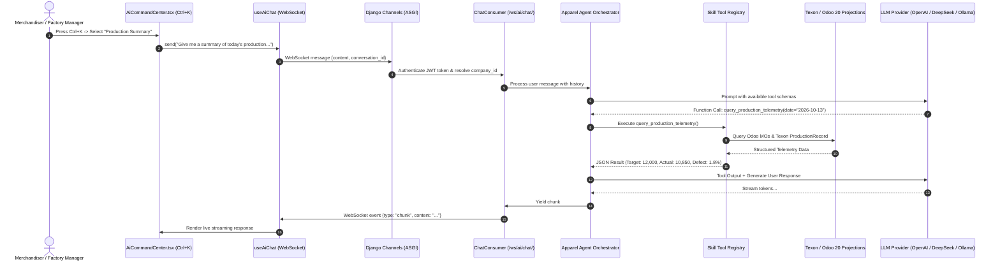

# Texon Apparel AI Copilot: Architecture & Integration Blueprint

> **Role:** Principal Enterprise Solutions & AI Systems Architect  
> **Target Systems:** Texon Next.js Frontend (`AiCommandCenter.tsx`) + Django Channels + Odoo 20.0 ERP  
> **Status:** Architecture Specification & Implementation Plan  

---

## Executive Summary & Codebase Context

During our audit of the codebase and Git history (`commit 6173e0b`), we discovered that Texon previously had a full AI subsystem under `backend/ai` containing:
- Multi-provider support (OpenAI, DeepSeek, LM Studio)
- Domain skills (`ProductionSkill`, `InventorySkill`, `SalesSkill`, `QualitySkill`, `EmployeeSkill`)
- WebSocket streaming via Django Channels (`AsyncWebsocketConsumer`)
- Frontend UI components: the `Cmd+K` / `Ctrl+K` command center ([AiCommandCenter.tsx](file:///home/afzal/Desktop/texon/frontend/texon-ui/components/global/AiCommandCenter.tsx)) and the streaming WebSocket hook ([use-ai-chat.ts](file:///home/afzal/Desktop/texon/frontend/texon-ui/hooks/use-ai-chat.ts)).

### Why Legacy AI Was Removed
In August 2026, the legacy AI module was removed (`chore: remove legacy AI module and supporting infrastructure`) because it suffered from a classic enterprise AI flaw: **it performed unconstrained reads and hallucinatory writes on top of mutable, unvalidated database records**. When `accounting_skill.py` queried draft journal entries or `inventory_skill.py` queried unverified raw balances, it produced misleading metrics.

In our primary ERP Adaptation Plan (Phases 1–10, Commits 001–225), we deliberately focused on **establishing the authoritative transactional ledger first** (Odoo 20.0 Community, reliable outbox messaging, inventory quants, and frozen BOMs). 

Now that the authoritative transactional bedrock is specified, this document provides the **Modernized AI Copilot Architecture** and **Phase 11 Implementation Backlog (Commits 226–240)**.

---

## 1. The Core AI Principles in Enterprise ERP

In mission-critical apparel manufacturing, generic conversational chatbots are dangerous. Fabric allocation, cost sheets, and cutting orders cannot be left to probabilistic guesswork.

1. **Zero Hallucinatory Writes:** The AI agent **NEVER** mutates database state directly. Any action proposed by the AI (e.g. *"Confirm Buyer PO #TX-901"*, *"Release Roll #104 from Quarantine"*) produces a structured **Action Confirmation Card** in the UI. A human operator must explicitly review and click to dispatch the command via the Transactional Outbox.
2. **Deterministic Tool Execution (RAG + Function Calling):** The LLM does not write raw SQL queries. It calls strictly typed, read-only Python tools that query validated Django projections and Odoo JSON-2 endpoints.
3. **Strict RBAC & Tenant Scoping:** The AI runs strictly inside the authenticated user's session context (`user.id`, `active_company_id`, `user.has_perm(...)`). A merchandiser chatting with the AI cannot access executive payroll or unassigned buyer margins.
4. **Hybrid Cloud / On-Premise Support:** The architecture supports cloud models (OpenAI GPT-4o, DeepSeek V3/R1, Anthropic Claude 3.5) while allowing local LLM backends (Ollama / vLLM / LM Studio) for factories requiring offline data sovereignty.

---

## 2. System Architecture: Next.js to Django Channels



---

## 3. Four Specialized Apparel Copilot Skills

### Skill 1: Production & Bottleneck Intelligence (`production_copilot`)
- **Triggers:** "Production Summary", "Line 4 bottleneck", "OEE report today".
- **Deterministic Tools:**
  - `get_daily_line_output(date, unit_id, line_id)`: Fetches hourly output against target SMV from `production.ProductionRecord`.
  - `detect_bottleneck_risks()`: Identifies operations where WIP buffer exceeds 2.5 hours or defect rate spikes above 3%.
  - `get_active_mo_progress(odoo_mo_id)`: Queries Odoo `mrp.production` status, reserved lots, and scrap percentages.

### Skill 2: Fabric Roll Inventory & Quarantine Analyst (`inventory_copilot`)
- **Triggers:** "Inventory Status", "Fabric stock for Style TX-901", "Quarantine alerts".
- **Deterministic Tools:**
  - `check_fabric_stock(fabric_code, required_meters)`: Checks available unallocated rolls in `WH/Stock`.
  - `get_quarantined_rolls()`: Lists rolls in `WH/Quarantine` awaiting 4-point inspection or shade grouping.
  - `query_roll_traceability(roll_lot_number)`: Traces roll from supplier dye batch to cut panels and finished garments.

### Skill 3: Commercial & Delivery Risk Analyzer (`merchandising_copilot`)
- **Triggers:** "Risk Assessment", "Buyer PO delivery dates", "Critical path delays".
- **Deterministic Tools:**
  - `analyze_order_lead_time(buyer_po_id)`: Compares Odoo delivery dates with current fabric receipt and cutting status.
  - `check_bom_material_readiness(style_id, order_qty)`: Evaluates whether all variant-specific fabrics and trims are on hand.
  - `flag_overdue_tna_tasks()`: Scans Time & Action milestones for pending sample approvals or fabric lab dips.

### Skill 4: Natural Language Command Drafter (Human-in-the-Loop)
- **Triggers:** "Confirm Buyer PO #104", "Release roll #R-902 from quarantine".
- **Behavior:**
  1. Validates prerequisites (e.g. ensures inspection score is logged before allowing release).
  2. Generates an RFC4122 `operation_uuid` and standard command payload.
  3. Returns a structured JSON message:
     ```json
     {
       "type": "action_proposal",
       "action": "release_roll_to_stock",
       "title": "Release Fabric Roll #R-902 to Available Stock",
       "details": {
         "lot": "R-902",
         "shade": "Group A",
         "meters": 120.5,
         "score": "4-Point Score: 12 (PASS)"
       },
       "command_endpoint": "/api/v1/commands/inventory/release-roll",
       "operation_uuid": "f81d4fae-7dec-11d0-a765-00a0c91e6bf6"
     }
     ```
  4. The frontend renders an interactive confirmation card with **[Confirm]** and **[Cancel]** buttons.

---

## 4. Phase 11 Implementation Backlog: AI Copilot Integration (Commits 226–240)

To complement the core 225-commit ERP roadmap, this standalone phase restores and modernizes the AI assistant:

### `COMMIT-226`: feat(ai): scaffold backend/ai application and register in settings
- **Target Files:** `backend/ai/apps.py`, `backend/ai/__init__.py`, `backend/config/settings.py`
- **Implementation Intent:** Re-register `ai` app in `INSTALLED_APPS` and define configuration settings (`AI_DEFAULT_PROVIDER`, `AI_MODEL_NAME`, `AI_API_KEY`).
- **Acceptance & Paired Tests:** Django boots cleanly; `manage.py check` passes without warnings.

### `COMMIT-227`: feat(ai): create conversation and message audit models
- **Target Files:** `backend/ai/models.py`, `backend/ai/migrations/0001_initial.py`
- **Implementation Intent:** Define `Conversation` (user, company, title, created_at) and `ChatMessage` (conversation, role, content, tool_calls, tokens_used).
- **Acceptance & Paired Tests:** Migration applies cleanly; unique indices created.

### `COMMIT-228`: feat(ai): implement ChatConsumer with JWT authentication and streaming
- **Target Files:** `backend/ai/consumers.py`, `backend/ai/routing.py`, `backend/config/asgi.py`
- **Implementation Intent:** Re-enable `ai.routing.websocket_urlpatterns` in `backend/config/asgi.py`. Implement `ChatConsumer` verifying JWT token from query string and managing WebSocket lifecycle.
- **Acceptance & Paired Tests:** Automated Channels test connects to `/ws/ai/chat/?token=<valid_token>` and receives connect acknowledgment.

### `COMMIT-229`: feat(ai): create LLM provider abstraction for OpenAI, DeepSeek and Ollama
- **Target Files:** `backend/ai/providers/base.py`, `backend/ai/providers/openai_provider.py`, `backend/ai/providers/deepseek_provider.py`, `backend/ai/providers/ollama_provider.py`
- **Implementation Intent:** Provider classes wrapping streaming client calls and converting OpenAI-compatible function calling schemas.
- **Acceptance & Paired Tests:** Unit tests mock provider streams and verify token yielding.

### `COMMIT-230`: feat(ai): implement SkillRegistry and deterministic tool execution engine
- **Target Files:** `backend/ai/registry.py`, `backend/ai/tools/executor.py`
- **Implementation Intent:** Registry allowing domain skills to register tool schemas and dispatch execution with user permission checks.
- **Acceptance & Paired Tests:** Registered tools return valid JSON schemas; executor handles parameters correctly.

### `COMMIT-231`: feat(ai): implement ProductionSkill for live MO and telemetry queries
- **Target Files:** `backend/ai/skills/production_skill.py`
- **Implementation Intent:** Tools querying Odoo `mrp.production` and Texon `production.ProductionRecord` (daily output, target vs actual, defect rates).
- **Acceptance & Paired Tests:** Skill queries return structured output without altering database.

### `COMMIT-232`: feat(ai): implement InventorySkill for fabric roll and lot tracking
- **Target Files:** `backend/ai/skills/inventory_skill.py`
- **Implementation Intent:** Tools querying Odoo `stock.quant` and `stock.lot` by shade, GSM, shrinkage, and quarantine status.
- **Acceptance & Paired Tests:** Test verifies querying fabric stock returns available roll count and quarantined lots.

### `COMMIT-233`: feat(ai): implement MerchandisingSkill for order critical-path risk analysis
- **Target Files:** `backend/ai/skills/merchandising_skill.py`
- **Implementation Intent:** Tools analyzing `merchandising.BuyerPurchaseOrder` lead times, BOM readiness, and delivery risks.
- **Acceptance & Paired Tests:** Test identifies order with missing fabric booking.

### `COMMIT-234`: feat(ai): implement CommandDraftingSkill for Human-in-the-Loop proposals
- **Target Files:** `backend/ai/skills/command_skill.py`
- **Implementation Intent:** Tool structuring action proposals with validated parameters and operation UUIDs for user confirmation.
- **Acceptance & Paired Tests:** Returns valid `action_proposal` JSON payload.

### `COMMIT-235`: security(ai): enforce RBAC and company isolation across all skill tools
- **Target Files:** `backend/ai/tools/executor.py`
- **Implementation Intent:** Validate `user.has_perm()` for every tool invocation; scope all ORM queries to `active_company_id`.
- **Acceptance & Paired Tests:** Unprivileged user calling HR tool receives permission denied message from agent.

### `COMMIT-236`: feat(frontend): implement Action Confirmation Card in AiCommandCenter.tsx
- **Target Files:** `frontend/texon-ui/components/global/AiCommandCenter.tsx`
- **Implementation Intent:** Render structured interactive cards for `action_proposal` messages with one-click dispatch to `/api/proxy/commands/*`.
- **Acceptance & Paired Tests:** Vitest verifies clicking confirm triggers operation dispatch hook.

### `COMMIT-237`: feat(frontend): connect useAiChat hook to live WebSocket with token rehydration
- **Target Files:** `frontend/texon-ui/hooks/use-ai-chat.ts`
- **Implementation Intent:** Replace static mock with authenticated WebSocket connection, handling `message_start`, `chunk`, and `message_end` events.
- **Acceptance & Paired Tests:** Test verifies streaming message assembly from chunks.

### `COMMIT-238`: feat(frontend): wire quick suggestions in AiCommandCenter to domain prompts
- **Target Files:** `frontend/texon-ui/components/global/AiCommandCenter.tsx`
- **Implementation Intent:** Wire Production Summary, Risk Assessment, Inventory Status, and HR Attendance suggestion pills to auto-send prompts.
- **Acceptance & Paired Tests:** Clicking pill submits prompt to chat session.

### `COMMIT-239`: test(ai): end-to-end integration test for AI chat streaming and tool execution
- **Target Files:** `backend/ai/tests/test_e2e_ai.py`
- **Implementation Intent:** Integration test simulating user WebSocket session asking for production summary and receiving streamed response.
- **Acceptance & Paired Tests:** Test passes against Channels test client.

### `COMMIT-240`: docs(ai): create operational runbook for AI providers and factory deployments
- **Target Files:** `docs/ai/01-ai-copilot-runbook.md`
- **Implementation Intent:** Document API key rotation, prompt tuning, token cost budgeting, and local Ollama GPU setup for garment factories.
- **Acceptance & Paired Tests:** Runbook reviewed and approved.
